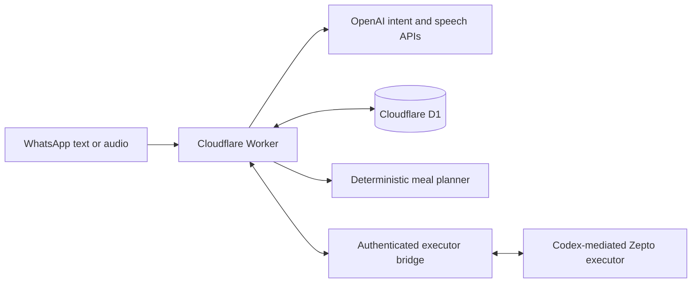

# MealWise — meal and grocery assistant

An AI-assisted product build that connects household meal planning, multilingual WhatsApp conversations, and human-approved grocery workflows.

## Why it exists
A household owner and cook repeatedly coordinate what to prepare and which ingredients are missing. MealWise turns that coordination into a persistent workflow: suggest meals, review or modify them, communicate with the cook, collect missing items, and request approval for an exact grocery basket.

## Implemented capabilities
- Deterministic breakfast/lunch/dinner selection from a curated catalog and embedded weekly menu, with weighted scores and repetition penalties.
- Structured English, Hindi and Hinglish intent interpretation with GPT-4.1 mini.
- Hindi audio transcription and speech generation.
- WhatsApp owner/cook roles, recipient messaging windows, meal changes, queued notifications and delayed voice delivery.
- Basket validation, fresh merchant-history evidence, expiry, budget limits, approval invalidation, checkout claims and payment reconciliation states.
- Cloudflare D1 persistence with schema migrations.

## Architecture

The backend stores decisions and constrains actions. Language models interpret messages; they do not independently prove merchant availability, payment success or purchase authority. The external executor must revalidate merchant terms and reconcile uncertain checkout outcomes.

## Product ownership and AI-assisted development
The project owner defined the household problem and iterated with Codex on meal variety, natural approvals, ingredient corrections, voice delivery and understandable failure recovery. Codex supported implementation, debugging and workflow tests. This is evidence of hands-on AI product development; it is not a claim that every component was manually authored.

## Verification
37 workflow tests passed in the source project on October 13, 2026. Tests cover meal variety, invalid previews, purchase approval boundaries, stale confirmations, budget limits, checkout claims, notification windows, revisions and recovery. External services are mocked; this is not a measured speech/intent accuracy benchmark or end-to-end merchant certification.

```sh
npm ci
npm run test:workflow
npm run dev
```
Requires Node.js 24 for the workflow test harness. `npm test` is inherited from the starter and builds/tests the placeholder web shell; `test:workflow` runs the product tests.

## Current limitations
- The web homepage remains a starter placeholder; the product interface is WhatsApp.
- Household configuration is a fixed sample, not general onboarding.
- Meal scores are hand-assigned heuristics, not clinically validated nutrition guidance.
- Grocery execution depends on an external authorized Codex/MCP session. An independent always-on receiver is not included.
- WhatsApp templates, credentials, D1 provisioning and merchant access require separate setup. This copy is not a turnkey deployment.
- Adoption, time savings and production success rates have not been measured.

## Public-source preparation
This portfolio copy omits personal voice recordings, operational conversation notes, live hosting identifiers and original Git history. Names and private menu references have been replaced with sample values. The working application is maintained separately.

See [the case study](docs/case-study.md) for the product decisions and [configuration](docs/configuration.md) for integration boundaries.
